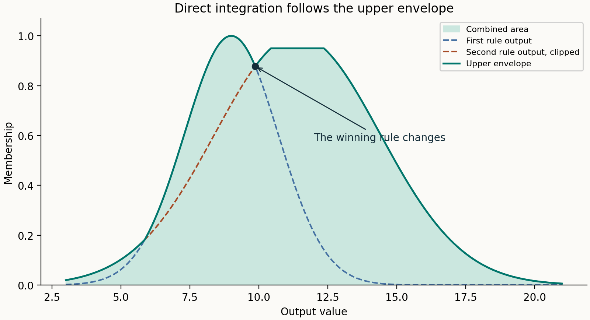
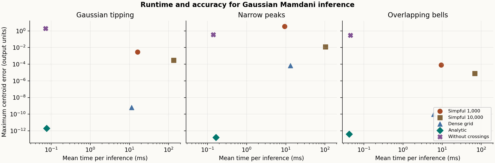
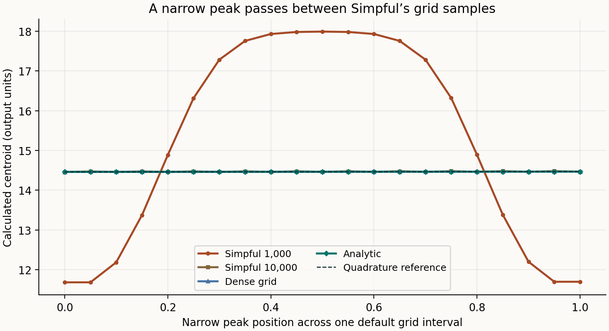

# Simpful: Reproduction and Limitation Tests of a Fuzzy Logic Library

AICC5102 Principles of AI, Fall 2026, Section 1. Team: Abdullah Jassim (60105581), Abdullah Mahmood (60100820), Syed Baqir (60323165).

**Research question** (as in the proposal). Under what conditions does Simpful's fuzzy inference lose numerical accuracy or become too slow to use, and how does it compare with Scikit-Fuzzy and an exact reference?

**Extension.** We change the Mamdani inference step and test its effect on accuracy and runtime. The Gaussian experiment asks whether analytic integration of clipped Gaussian output sets reduces error and runtime relative to fixed grids.

Paper: S. Spolaor et al., "Simpful: A User-Friendly Python Library for Fuzzy Logic," *Int. J. Computational Intelligence Systems* 13(1):1687–1698, 2020. https://doi.org/10.2991/ijcis.d.201012.002
Original code: https://github.com/aresio/simpful and https://codeocean.com/capsule/2230971/tree

## What this project does

1. **Reproduces** the four examples in the paper (Listings 1–4) and the Fig. 4 comparison with Scikit-Fuzzy.
2. **Tests two limitations** of Simpful 2.12.0:
   - **A, accuracy:** Mamdani answers are estimated on a grid of points (1000 by default), so they are slightly off.
   - **B, speed:** time grows in proportion to the number of rules (6561 rules take about 13.5 s per answer).
   - **Harder conditions** (`limitation_A_harder.py`): narrow and Gaussian/sigmoid output sets.
   - **Scikit-Fuzzy comparison** (`limitation_B_skfuzzy.py`): same rule bases, same inputs.
3. **Changes one part of the method**, the inference step (`fast_mamdani.py`, `fast_sugeno.py`): an exact centroid (the method PyFuzzy uses for polygon sets) as the reference, plus evaluating only the rules that can fire, which Simpful does not do.
4. **Locates the cost** with two ablations: removing one component of `fast_mamdani` at a time (`ablation.py`), and Mamdani vs Sugeno on the same rule base (`ablation_mamdani_vs_sugeno.py`, as planned in the proposal).
5. **Tests our changes** (`test_fast_mamdani.py`) and **finds and fixes two issues the paper does not discuss**: Simpful's Sugeno rule weights are not a weighted average (`findings_checks.py`, fixed in `fast_sugeno.py`), and the sepsis membership labels are inverted (`sepsis_corrected.py`).

## Setup

Python 3.11 or newer.

```bash
pip install -r requirements.txt
```

Package versions are pinned in `requirements.txt`; the exact Python and package versions of each run are written at the top of `results/all_results.txt`. NumPy 2.0 or newer is required (`np.trapezoid`). `setuptools<81` is pinned because Simpful 2.12.0 imports `pkg_resources` when it prints its start-up banner (`FuzzySystem()` without `show_banner=False`), and newer setuptools no longer includes it.

## How to reproduce all results

```bash
python run_all.py
```

This runs every script below in order and writes **`results/all_results.txt`**, about 35–40 minutes in total. The file starts with the Python, package versions and CPU model used. To run only some scripts, name them:

```bash
python run_all.py benchmark_gaussian_centroid test_gaussian_centroid
```

A partial run like this writes `results/results_<names>.txt`, so it never overwrites the full `all_results.txt`; the results file is saved after every script. Each script can also be run on its own, e.g. `python ablation.py`. The tests also run with `pytest test_fast_mamdani.py`. Run the timings on an otherwise idle computer; absolute times differ between machines, but the speed-up ratios should be similar.

## Files

| File | Purpose |
|---|---|
| `mamdani.py`, `sugeno.py`, `sepsis.py`, `repressilator.py` | The authors' example scripts (Listings 1–4) |
| `figure4_test.py` | Fig. 4: Simpful vs Scikit-Fuzzy output surface, 21 × 21 grid, and each library's error against the exact reference |
| `limitation_A_fixed.py` | Limitation A: accuracy vs number of subdivisions, at (4, 8) and over 121 inputs, Simpful vs ours |
| `limitation_B_fixed.py` | Limitation B: time and memory for random rule bases with 2–8 inputs (9–6561 rules), 5 seeds |
| `limitation_A_harder.py` | Limitation A, harder conditions: narrow, Gaussian and sigmoid output sets, 121 inputs |
| `limitation_B_skfuzzy.py` | Limitation B with Scikit-Fuzzy: same rule bases and inputs, time and error vs the exact result |
| `temperature_control_mamdani.py` | A second Mamdani system (fan control, 9 rules), accuracy over 56 inputs and time |
| `benchmark_sepsis_sugeno.py` | Sugeno system (sepsis): equivalence over 10,001 inputs and time |
| `ablation.py` | Ablation study: removes active, cache, merge, exact and vector one at a time, plus merge and exact together |
| `ablation_mamdani_vs_sugeno.py` | Proposal ablation: Mamdani vs Sugeno on the same rule base, to separate defuzzification cost from rule-evaluation cost |
| `test_fast_mamdani.py` | Tests: grid mode equals Simpful (n = 10, 100, 1000), exact mode equals the reference, `fast_sugeno` equals Simpful, active-rule lookup changes nothing |
| `findings_checks.py` | Checks Sugeno rule weights (and shows our fix) and the sepsis membership labels |
| `sepsis_corrected.py` | Fix for the sepsis labels: original vs labels fixed vs labels fixed + creatinine partition, at the paper's input and over 10,000 inputs |
| `sepsis_version_check.py`, `check_old_simpful.sh` | Reruns Listing 3 under older Simpful versions to explain 69.3 vs 68.90 |
| `gaussian_centroid.py` | Analytic centroid for clipped Gaussian outputs under max aggregation |
| `benchmark_gaussian_centroid.py`, `test_gaussian_centroid.py` | Gaussian accuracy and timing, crossing ablation, figures, and regression tests |
| `fast_mamdani.py` | Our replacement of Simpful's Mamdani inference step |
| `fast_sugeno.py` | Our replacement of Simpful's zero-order Sugeno inference step; `weights="average"` fixes the rule-weight bug |
| `common.py` | Shared timing and memory helpers, so every test is measured the same way |
| `run_all.py` | Runs everything and writes `results/all_results.txt` |
| `results/` | Combined results, CSV and figures |

## The changed part of the method (`fast_mamdani.py`)

Only the inference step changes; fuzzy sets, rules and operators are Simpful's own. It has five components, each of which can be switched off:

| Component | What it does |
|---|---|
| `active` | Evaluates only the rules that can fire. Rules that are an AND of one term per input are indexed by their terms; at inference only combinations of non-zero terms are looked up. With triangular partitions this touches at most 2ⁿ of the 3ⁿ rules (256 of 6561 at 8 inputs). Other rules (OR, NOT) are evaluated normally. Skipped rules have firing strength exactly 0, so results do not change (test T5). Known from fuzzy hardware (Chen et al., JCIS 2006); Simpful evaluates every rule. |
| `cache` | Computes each input's membership values once per inference (Simpful recomputes them for every rule) and applies AND/OR/NOT directly instead of through `eval()` |
| `merge` | Combines rules with the same output term by the maximum of their strengths (mathematically identical under max aggregation) and drops rules that do not fire |
| `exact` | For triangular, trapezoidal and point-based output sets, computes the centroid exactly between breakpoints, clip levels and crossings instead of on a grid. This is the method PyFuzzy uses for polygon sets; we use it as the exact reference. Pure Gaussian outputs use analytic integration. Other nonlinear combinations use a 200,001-point trapezoidal grid. |
| `vector` | Uses NumPy arrays instead of Python loops when a grid is needed |

`exact=False` selects the Simpful-compatible grid. The optional `strict` argument remains available to existing callers.

## How everything is timed

All scripts use `common.time_ms`: one warm-up call, then 5 timed runs (3 per seed in the random-rule-base tests), reported as **mean ± standard deviation in ms**. Memory is measured in a separate call, because the memory tracker slows Python down. Simpful always runs at its default 1000 subdivisions unless a test varies that setting on purpose. Random rule bases use 5 seeds (1–5).

## Main results

The reproduction, earlier accuracy tests, and scalability figures below come from `results/historical_all_results.txt` in the project ZIP. The Gaussian benchmark uses the results recorded in the current `results/all_results.txt` and `results/gaussian_centroid_summary.csv`. The Gaussian run used Python 3.12.10, NumPy 2.2.5, SciPy 1.18.1, and Matplotlib 3.10.1. The historical run used the environment below. Python 3.14.2, Windows, Intel Core (Family 6 Model 142), simpful 2.12.0, scikit-fuzzy 0.5.0, numpy 2.4.4. Absolute times depend on the machine; ratios are what matter.

**Reproduction**

| Example | Paper | Ours (Simpful 2.12.0) |
|---|---|---|
| Listing 1, Mamdani tip | 14.17 | 14.172 (Simpful 2.9.0 gives the same to 14 digits) |
| Listing 2, Sugeno tip | 14.77 | 14.778 (true value 14.777…; the paper truncated) |
| Listing 3, sepsis | 69.3 | 68.903 (independent analytic calculation agrees; gap not yet explained) |
| Listing 4, repressilator | oscillates | oscillates (`results/repressilator_dynamics.pdf`) |
| Fig. 4, Simpful vs Scikit-Fuzzy | "identical" | max difference 0.0114, mean 0.0036 over 441 inputs |

Fig. 4 explained: against the exact reference, Simpful's max error is 1.14e-2, Scikit-Fuzzy's is 2.1e-11 and ours 2.1e-11. The grid accounts for the observed difference in this comparison.

**Limitation A, accuracy (tipping, 121 inputs)**

| Method | Max error | Mean error | Time at (4, 8) |
|---|---|---|---|
| Simpful, 100 subdivisions | 0.114 | 0.038 | 0.79 ± 0.09 ms |
| Simpful, 1000 (default) | 0.0114 | 0.0037 | 6.59 ± 1.01 ms |
| Simpful, 10000 | 0.00114 | 0.00037 | 63.1 ± 3.4 ms |
| Ours (exact) | 2.1e-11 | 4.0e-12 | 0.62 ± 0.02 ms |

Error falls 10× for every 10× more subdivisions, and time grows 10×.

**Earlier harder-condition run (121 inputs, max error)**

| Output sets | Simpful 100 | Simpful 1000 | Simpful 10000 | Ours | Time: Simpful 1000 / ours |
|---|---|---|---|---|---|
| Narrow (width 1–3) | 0.149 | 2.0e-5 | 2.0e-7 | 1.1e-14 (exact) | 7.5 / 1.8 ms |
| Gaussian | 0.030 | 0.0030 | 0.00030 | 6.2e-10 (fine grid) | 25.3 / 32.1 ms |
| Sigmoid / Gaussian | 0.090 | 0.0090 | 0.00090 | 3.5e-10 (fine grid) | 13.5 / 38.1 ms |

This table records the earlier implementation. The Gaussian row shows the former dense-grid fallback. The updated experiment below compares that same fallback with the analytic method. Mixed sigmoid/Gaussian outputs still use the fine grid.

## Analytic centroid for clipped Gaussian outputs

A Mamdani rule caps the height of its output bell at the firing strength. Max aggregation takes the upper envelope of those capped bells. The centroid is the first moment of that envelope divided by its area.

`gaussian_centroid.py` partitions the output domain at Gaussian–Gaussian crossings and where Gaussian curves meet clipping heights. Between those points, a single expression describes the envelope: a flat segment or a Gaussian tail. The implementation integrates each segment using the normal cumulative distribution function for area and an exponential expression for the first moment. The calculation avoids sampling a fixed grid and is subject to floating-point rounding.



**Comparison.** The benchmark covers the 121 input pairs of the Gaussian tipping test through equivalent firing strengths, a 21-position narrow-peak sweep within one default grid interval, and 12 overlapping-bell cases. Each method receives the same rules and inputs. An independently implemented SciPy numerical quadrature with peak and clipping hints supplies the reference. Timings are means per inference over five timed batches after a warm-up, including input assignment and excluding reference and system construction.

| Case group | Method | Max absolute error | Mean ms per inference |
|---|---|---:|---:|
| Gaussian tipping | Simpful 1,000 | 3.00e-03 | 16.060 |
| Gaussian tipping | Simpful 10,000 | 3.01e-04 | 135.536 |
| Gaussian tipping | Dense grid | 6.16e-10 | 11.384 |
| Gaussian tipping | Analytic | 1.98e-12 | 0.077 |
| Gaussian tipping | Without crossings | 1.93e+00 | 0.072 |
| Narrow peaks | Simpful 1,000 | 3.53e+00 | 9.369 |
| Narrow peaks | Simpful 10,000 | 1.24e-02 | 103.045 |
| Narrow peaks | Dense grid | 6.67e-05 | 13.080 |
| Narrow peaks | Analytic | 1.58e-13 | 0.164 |
| Narrow peaks | Without crossings | 3.61e-01 | 0.141 |
| Overlapping bells | Simpful 1,000 | 7.83e-05 | 9.453 |
| Overlapping bells | Simpful 10,000 | 7.91e-06 | 68.105 |
| Overlapping bells | Dense grid | 9.67e-11 | 6.124 |
| Overlapping bells | Analytic | 4.10e-13 | 0.043 |
| Overlapping bells | Without crossings | 2.95e-01 | 0.046 |

On the 121 Gaussian tipping cases, the analytic method was about 148× faster than the 200,001-point grid (11.384 ms versus 0.077 ms). In the narrow-peak sweep, the default grid missed enough of the narrow bell to move the centroid by up to 3.53 output units. Removing the Gaussian–Gaussian crossing calculation raised the maximum error to 0.295 on the overlapping-bell group. Crossing detection preserves the points at which the dominant bell changes.





The benchmark produces `results/gaussian_centroid_summary.csv` and `results/gaussian_centroid_cases.csv` with the measured and per-case values. `analytic_gaussian=False` selects the old dense-grid method for comparison. `gaussian_crossings=False` is the diagnostic ablation. Use the default settings for inference.

**Limitation B, speed (random full-grid rule bases, 5 seeds)**

| Inputs | Rules | Simpful | Ours | Ours vs Simpful |
|---|---|---|---|---|
| 2 | 9 | 21.5 ± 4.0 ms | 0.82 ± 0.14 ms | 26× |
| 4 | 81 | 166 ± 13 ms | 0.81 ± 0.22 ms | 206× |
| 6 | 729 | 1,557 ± 160 ms | 0.85 ± 0.04 ms | 1,836× |
| 8 | 6,561 | 13,459 ± 2,868 ms | 1.53 ± 0.25 ms | 8,783× |

Simpful's time grows about 9× for every 9× more rules. At most 2ⁿ of the 3ⁿ rules can fire. Peak memory was 0.07–0.89 MB for Simpful and 0.01 MB for our method.

Run only the uncapped comparison with `python run_all.py limitation_B_skfuzzy`. The [new results](results/results_limitation_B_skfuzzy.txt) use Python 3.11.9 and Scikit-Fuzzy 0.5.0. Each of the five seeds uses the same rule base and input for both methods, with one warm-up and three timed calls. Scikit-Fuzzy builds the fixed rule graph once per seed and reuses its rule order. Its inference evaluates every rule with result caching disabled. The earlier combined logs record their original capped runs.

| Rules | Scikit-Fuzzy build | Scikit-Fuzzy inference | Our inference | Our speed-up | Max. output difference |
|---|---:|---:|---:|---:|---:|
| 9 | <0.01 s | 2.03 ± 0.05 ms | 0.61 ± 0.05 ms | 3.3× | 7.76e-6 |
| 81 | 0.04 s | 4.83 ± 1.58 ms | 0.58 ± 0.31 ms | 8.3× | 2.70e-6 |
| 729 | 0.51 s | 36.85 ± 8.76 ms | 0.57 ± 0.26 ms | 64.3× | 4.62e-6 |
| 6,561 | 5.78 s | 383.51 ± 15.99 ms | 1.17 ± 0.52 ms | 328.1× | 2.85e-6 |

**Other systems**

- Fan control (2 inputs, 9 rules, 56 inputs): Simpful max error 0.0346, ours 1.4e-10; 16.96 vs 0.68 ms (25×). At (29, 60): reference 61.2596, Simpful 61.2811, ours 61.2596.
- Sepsis (Sugeno): identical outputs on 10,001 inputs (max difference 0); 0.350 vs 0.024 ms (15×).

**Ablation 1: remove one component of `fast_mamdani` (time at 8 inputs, 6,561 rules)**

| Configuration | Tipping max error | 4 inputs | 6 inputs | 8 inputs |
|---|---|---|---|---|
| Simpful | 1.1e-2 | 233 ms | 1,692 ms | 16,191 ms |
| Full method | 2.1e-11 | 0.7 ms | 1.3 ms | 1.8 ms |
| − active | 2.1e-11 | 1.3 ms | 5.5 ms | 44.4 ms |
| − cache | 2.1e-11 | 2.8 ms | 13.5 ms | 71.8 ms |
| − merge | 2.1e-11 | 2.5 ms | 10.1 ms | 98.8 ms |
| − exact (NumPy grid) | 1.1e-2 | 0.8 ms | 1.5 ms | 3.0 ms |
| − exact − vector | 1.1e-2 | 7.1 ms | 6.2 ms | 7.8 ms |
| − merge − exact | 1.1e-2 | 0.8 ms | 2.8 ms | 18.7 ms |

- **exact** gives all of the accuracy gain, and at scale it is even faster than the grid (1.8 vs 3.0 ms).
- **cache**, **merge** and **active** each matter at scale (40×, 55× and 25× slower without them at 6,561 rules). Each grows in importance with the rule count.
- **merge and exact interact**: without merge, the exact centroid compares every pair of rule output sets. With `active` on, "− merge" now costs 99 ms instead of the > 20 s measured before `active` was added.

**Ablation 2: Mamdani vs Sugeno on the same rule base (proposal)**

| Inputs | Simpful Mamdani | Simpful Sugeno | Runtime gap (% of Mamdani) | Ours Mamdani | Ours Sugeno |
|---|---|---|---|---|---|
| 2 | 17.8 ms | 0.54 ms | 97% | 0.66 ms | 0.02 ms |
| 4 | 143 ms | 11.4 ms | 92% | 0.87 ms | 0.34 ms |
| 6 | 1,688 ms | 200 ms | 88% | 1.05 ms | 4.08 ms |
| 8 | 14,649 ms | 1,998 ms | 86% | 1.45 ms | 40.2 ms |

The Mamdani–Sugeno timing difference is 86–97% of Mamdani runtime on these systems. It estimates grid overhead because the inference methods also differ in their output calculations. After our change, our Mamdani is faster than our own Sugeno at 6 and 8 inputs, because `fast_sugeno` has no active-rule lookup: at scale, evaluating every rule costs more than defuzzification.

**Tests** (`test_fast_mamdani.py`): all 8 pass. Grid mode equals Simpful to 1.3e-13 (T1); exact mode equals the reference to 1.9e-10 (T2, T3); `fast_sugeno` equals Simpful exactly (T4); active-rule lookup changes nothing (T5, difference 0); the rule-weight fix gives true weighted averages and equals Simpful when unweighted (T6, difference 0).

**Findings** (`findings_checks.py`)

- **F1, Sugeno rule weights: confirmed bug.** One rule with weight 0.5 that fires fully returns 5.0 instead of its crisp value 10.0; two rules (weights 0.5 and 1.0, values 10 and 20) return 12.5 instead of the weighted average 16.67. Simpful multiplies the weight into the numerator only. Mamdani weights behave correctly (F1b).
  **Fix:** `fast_sugeno(..., weights="average")` multiplies the weight into both numerator and denominator, so that the result is normalized by the weighted firing strength. With the fix, the weight-0.5 rule returns 10.0 and the two-rule case 16.667, both the correct weighted averages. Test T6 confirms this and that the fix equals Simpful exactly when all weights are 1 (difference 0 over 200 sepsis inputs). The default (`"simpful"`) keeps Simpful's behaviour so the reproduction is unchanged.
- **F2, sepsis labels: confirmed inverted.** "low" PaO2 has membership 0.047 at PaO2 = 10 and 0.953 at 70; the same holds for platelets and creatinine. The two creatinine terms are off from a partition by up to 0.150 (at 289).
  **Fix:** `sepsis_corrected.py` swaps the shapes so "low" means low, and optionally gives both creatinine terms slope 0.1 so they form a partition; rules and inputs stay as printed. After the fix, "low" PaO2 has membership 0.953 at PaO2 = 10 and 0.047 at 70, as it should, and with the partition the creatinine gap is 0.000.

| Version | Output at the paper's input | Mean change over 10,000 inputs | Max change | Moves to the other side of 50% |
|---|---|---|---|---|
| Original (as printed) | 68.90% | — | — | — |
| Labels fixed | 7.14% | 76.4 points | 98.0 | 78.2% of inputs |
| Labels fixed + partition | 31.10% | 76.9 points | 98.0 | 80.1% of inputs |

Fixing the labels reverses the model's conclusion for about 4 in 5 inputs, so the paper's example output depends on the inverted labels. This fixes the labels, not the clinical model: with correct labels, whether the paper's two rules make clinical sense needs a clinician.

The Gaussian regression suite also passed five checks, including 36 randomized comparisons with independent quadrature. The quadrature reported roundoff warnings on some randomized cases. The regression comparisons use a tolerance of 5e-9 output units.

## References for the changed part

- NIST DLMF, §7.2, Gaussian integral and error function: https://dlmf.nist.gov/7.2

- PyFuzzy, fuzzy.set.Polygon.getCOG and fuzzy.set.operations.merge (exact centroid of polygon sets): https://pyfuzzy.sourceforge.net/
- S.-H. Huang, S.-Z. Liu, Y.-R. Chen, J.-Y. Lai, "High-Speed Fuzzy Inference Processor Using Active Rules Identification," JCIS 2006, doi:10.2991/jcis.2006.279
- Scikit-Fuzzy (comparison library): https://github.com/scikit-fuzzy/scikit-fuzzy

## Known limitations

- The analytic Gaussian path covers ordinary Gaussian outputs with max aggregation. When a firing term has a different nonlinear shape, inference uses the existing numerical fallback.
- `fast_sugeno` supports crisp (zero-order) outputs only and keeps Simpful's rule-weight behaviour.
- The paper's sepsis value (69.3) differs from Simpful 2.12.0 (68.90). An independent hand calculation agrees with 68.90. To test whether a version change explains it, run `bash check_old_simpful.sh <versions>` with versions from around October 2020 (see "Sepsis gap" below).
- In Simpful 2.12, a Sugeno rule weight multiplies the numerator only, so weighted outputs are not weighted averages (confirmed by F1). `fast_sugeno` keeps this behaviour by default so outputs equal Simpful's; `weights="average"` is the fix.
- The sepsis example's output depends strongly on the label fix (68.90% → 7.14% or 31.10% at the paper's input, and the conclusion flips for about 80% of random inputs), so the printed example is sensitive to the membership label assignment.
- The Scikit-Fuzzy comparison uses a preordered rule graph for independent, single-stage rules.
- Simpful 2.12.0's start-up banner needs `pkg_resources` (setuptools < 81), so the paper's example scripts fail on a fresh Python 3.14 install without that pin.
- In Listing 3, the terms called "low" use an increasing sigmoid and "high" a decreasing one, and the two creatinine terms use different slopes, so they do not add up to 1. `findings_checks.py` (F2) prints the memberships at clearly low and high values.
- The sepsis model is the paper's illustrative example, not clinically validated, and was not tested on patient data.
- Prior work covers polygon centroids and active-rule lookup. This project adds a Simpful implementation of analytic integration for clipped Gaussian outputs and measures the effect of crossing detection. The Gaussian integral itself is established mathematics.
- The active-rule lookup only helps rules written as an AND of one term per input; rules with OR or NOT are still evaluated one by one.
- `fast_sugeno` has no active-rule lookup.

## Sepsis gap

```bash
bash check_old_simpful.sh 2.0.0 2.1.0 2.12.0     # pick versions from https://pypi.org/project/simpful/#history
```

Each version is installed in a temporary virtual environment (with NumPy < 2, which old releases need), Listing 3 is run exactly as printed in the paper, and the result is appended to `results/sepsis_version_check.txt`. Needs internet access for `pip`.

## Team contributions

| Member | Contribution |
|---|---|
| Abdullah Jassim (60105581) | Reproduction of Listings 1–4 and Fig. 4 (`mamdani.py`, `sugeno.py`, `sepsis.py`, `repressilator.py`, `figure4_test.py`), high-resolution reference, sepsis version check, README |
| Abdullah Mahmood (60100820) | Accuracy tests (`limitation_A_fixed.py`, `limitation_A_harder.py`), second Mamdani system (`temperature_control_mamdani.py`), correctness checks and fixes (`findings_checks.py`, `sepsis_corrected.py`) |
| Syed Baqir (60323165) | Scalability benchmark (`limitation_B_fixed.py`, `limitation_B_skfuzzy.py`), Sugeno benchmark, ablations (`ablation.py`, `ablation_mamdani_vs_sugeno.py`), tests (`test_fast_mamdani.py`), statistics and plots |
| All | `fast_mamdani.py` / `fast_sugeno.py` design and review, related work, paper, peer review |

## AI use statement

Claude (Anthropic) was used to help write `fast_mamdani.py`, `common.py`, `ablation.py`, `run_all.py`, `test_fast_mamdani.py`, `findings_checks.py`, `sepsis_version_check.py`, `check_old_simpful.sh`, `limitation_A_harder.py`, `limitation_B_skfuzzy.py`, `ablation_mamdani_vs_sugeno.py` and `sepsis_corrected.py`, to add the active-rule lookup to `fast_mamdani.py` and the rule-weight fix to `fast_sugeno.py`, to adapt the test scripts to the common timing method, and to draft this README. ChatGPT assisted with the Gaussian centroid implementation, benchmark, tests, figures, and this revision of the README.
